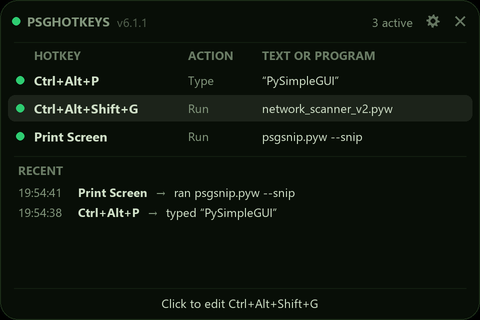

<p align="center">
  <p align="center"><p>

  <h2 align="center">psghotkey</h2>
  <h2 align="center">A Windows Hotkey Tool</h2>
  <h2 align="center">A PySimpleGUI Application</h2>
</p>


<p align="center">
  
</p>

## Features

* A complete hotkey manager - a key combination inserts text or launches a program
* On Windows each hotkey is registered with Windows itself, so the keys never reach the program underneath
* Lives in the system tray - its card has a row per hotkey that lights up as it fires
* 32 themes and Brightness
* Demonstrates integrating the system tray into your application

## Adding your hotkeys

1. Click the tray icon for psghotkey's card, then its gear (or right-click > Hotkeys...) to open the Hotkeys window.
2. Add a hotkey: click Rec and press the keys you want.
3. Choose what it does: insert text, or launch a program.

Your hotkeys are saved in your own psghotkey.json settings file, so upgrading never loses them.  Right-click the card for its 32 themes and Brightness.


## Installation

### Using PIP with PyPI

The latest official release of PySimpleGUI products can be found on PyPI.  To pip install psghotkey from PyPI, use this command

#### If you use the command `python` on your computer to invoke Python (Windows):

`python -m pip install --upgrade psghotkey`

#### If you use the command `python3` on your computer to invoke Python (Linux, Mac):

`python3 -m pip install --upgrade psghotkey`

### Using PIP with GitHub

You can also pip install the PySimpleGUI Applications that are in the PySimpleGUI GitHub account.  The GitHub versions have bug fixes and new programs/features that have not yet been released to PyPI. To directly pip install from that repo:

#### If you use the command `python` on your computer to invoke Python (Windows):

```bash
python -m pip install --upgrade https://github.com/PySimpleGUI/psghotkey/zipball/main
```

#### If you use the command `python3` on your computer to invoke Python (Linux, Mac):

```bash
python3 -m pip install --upgrade https://github.com/PySimpleGUI/psghotkey/zipball/main
```


## Usage

Once installed, launch psghotkey by typing the following in your command line:

`psghotkey`

# Packages Used

This project uses these pip installable packages:
* PySimpleGUI
* psgtray
* keyboard
* Pillow

The system tray code is from [psgtray](https://github.com/PySimpleGUI/psgtray).  The psgtray package is an important add-on to the tkinter port of PySimpleGUI as it enables you to run your applications in the system tray.


# Windows Only (most likely)

`psgtray` runs the best on Windows and is used in this project. It's not been tried on Linux (recently) nor the Mac.

## License & Copyright

Copyright 2023-2026 PySimpleGUI.

Licensed under LGPL3.


## Contributing

I'm happy to receive issues describing bug reports and feature
requests! The project does not accept pull requests.  
